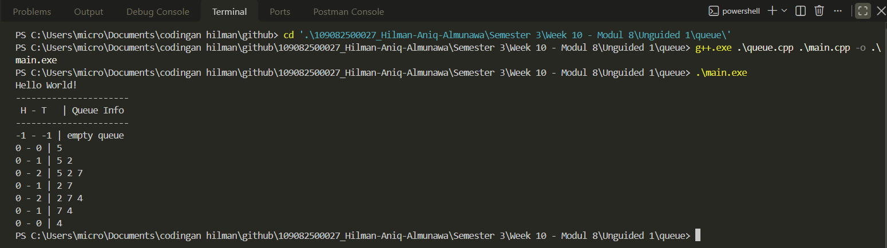
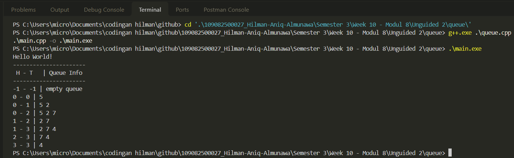
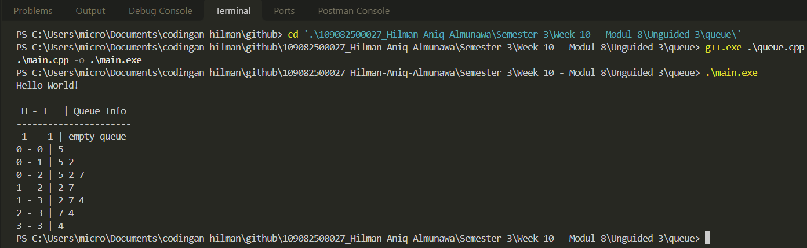

# <h1 align="center">Laporan Praktikum Modul 8 - QUEUE</h1>
<p align="center">Hilman Aniq Almunawa - 109082500027</p>

## Dasar Teori
Queue merupakan salah satu struktur data linear yang menggunakan prinsip FIFO (First In First Out), yaitu elemen yang pertama dimasukkan akan menjadi elemen pertama yang dikeluarkan. Struktur data ini bekerja seperti antrean pembelian tiket, di mana orang yang datang lebih dahulu akan mendapatkan pelayanan lebih awal. Queue memiliki dua operasi utama, yaitu enqueue untuk menambahkan elemen pada bagian belakang antrean dan dequeue untuk mengambil atau menghapus elemen pada bagian depan antrean. Dalam struktur Queue, bagian depan disebut Head, sedangkan bagian belakang disebut Tail (Modul 8, t.t.). Menurut Goodrich, Tamassia, dan Goldwasser (2013), Queue merupakan struktur data yang membatasi proses penyisipan pada bagian belakang dan penghapusan pada bagian depan sehingga elemen diproses berdasarkan urutan kedatangannya.

Implementasi Queue dapat dilakukan menggunakan dua representasi, yaitu Linked List dan Array. Pada representasi Linked List, setiap elemen disimpan dalam sebuah node yang memiliki bagian info untuk menyimpan data dan next untuk menunjuk ke elemen berikutnya. Struktur ini menggunakan pointer Head sebagai penunjuk elemen paling depan dan Tail sebagai penunjuk elemen paling belakang. Sementara itu, pada representasi Array, elemen disimpan menggunakan tabel dengan indeks Head dan Tail sebagai penanda posisi elemen pertama dan terakhir. Pada representasi Array, terdapat tiga alternatif pengelolaan Queue, yaitu Head diam dan Tail bergerak, Head dan Tail bergerak, serta Head dan Tail berputar atau Circular Queue. Ketiga alternatif tersebut memiliki cara pengelolaan indeks yang berbeda dalam proses penambahan dan penghapusan elemen (Modul 8, t.t.; Goodrich et al., 2013).

## Guided 1

### 1. queue.h
```C++
#ifndef QUEUE_H_INCLUDE
#define QUEUE_H_INCLUDE

#include <iostream>
using namespace std;

#define Nil NULL

typedef bool boolean;
typedef int infotype;
typedef struct elmQ *address;

struct elmQ {
    infotype info;
    address next;
};

struct queue {
    address head, tail;
};

boolean isEmpty(queue Q);
void CreateQueue(queue &Q);
address alokasi(infotype X);
void dealokasi(address P);
address findElm(queue Q, infotype X);
boolean fFindElm(queue Q, address P);
void insert(queue &Q, address P);
void deleteQueue(queue &Q, address &P);
void printInfo(queue Q);
int nbList(queue Q);
void delAll(queue &Q);

#endif
```
#### penjelasan guided 1
Pada file `queue.h`, dibuat struktur data Queue menggunakan Linked List untuk menyimpan data bertipe integer. Di dalamnya terdapat `info` untuk menyimpan data dan `next` sebagai penunjuk ke elemen berikutnya, serta `head` dan `tail` untuk menunjukkan elemen pertama dan terakhir. Selain itu, terdapat deklarasi fungsi yang digunakan untuk mengelola Queue, seperti membuat Queue kosong, menambahkan dan menghapus elemen, mencari data, serta menampilkan dan menghitung jumlah elemen.

### 2. queue.cpp
```C++
#include "queue.h"

boolean isEmpty(queue Q) {
    return (Q.head == Nil);
}

void CreateQueue(queue &Q) {
    Q.head = Nil;
    Q.tail = Nil;
}

address alokasi(infotype X) {
    address P = new (nothrow) elmQ;
    if (P != Nil) {
        P->info = X;
        P->next = Nil;
    }
    return P;
}

void dealokasi(address P) {
    delete P;
}

address findElm(queue Q, infotype X) {
    address P = Q.head;
    while (P != Nil) {
        if (P->info == X) {
            return P;
        }
        P = P->next;
    }
    return Nil;
}

boolean fFindElm(queue Q, address P) {
    address R = Q.head;
    while (R != Nil) {
        if (R == P) {
            return true;
        }
        R = R->next;
    }
    return false;
}

void insert(queue &Q, address P) { //enqueue
    if (isEmpty(Q)) {
        Q.head = P;
        Q.tail = P;
    } else {
        (Q.tail)->next = P;
        Q.tail = P;
    }
}

void deleteQueue(queue &Q, address &P) { //dequeue
    P = Q.head;
    if (Q.head == Q.tail) {
        Q.head = Nil;
        Q.tail = Nil;
    } else {
        Q.head = P->next;
    }
    P->next = Nil;
}

void printInfo(queue Q) {
    if (isEmpty(Q)) {
        cout << "Queue kosong" << endl;
    } else {
        address P = Q.head;
        while (P != Nil) {
            cout << P->info << " ";
            P = P->next;
        }
        cout << endl;
    }
}

int nbList(queue Q) {
    int jumlah = 0;
    address P = Q.head;
    while (P != Nil) {
        jumlah++;
        P = P->next;
    }
    return jumlah;
}

void delAll(queue &Q) {
    address P;
    while (!isEmpty(Q)) {
        deleteQueue(Q, P);
        dealokasi(P);
    }
}
```
#### penjelasan guided 2
Pada file `queue.cpp`, dibuat implementasi dari fungsi-fungsi yang digunakan untuk mengelola Queue menggunakan Linked List. Fungsi `isEmpty` digunakan untuk mengecek apakah Queue kosong, sedangkan `CreateQueue` untuk membuat Queue baru. Fungsi `alokasi` dan `dealokasi` digunakan untuk mengalokasikan dan menghapus memori. Selain itu, terdapat fungsi `findElm` dan `fFindElm` untuk mencari elemen, `insert` untuk menambahkan data ke bagian belakang Queue, serta `deleteQueue` untuk menghapus data dari bagian depan Queue. Fungsi `printInfo` digunakan untuk menampilkan isi Queue, `nbList` untuk menghitung jumlah elemen, dan `delAll` untuk menghapus seluruh elemen dalam Queue.

### 3. main.cpp
```C++
#include <iostream>
#include "queue.h"
using namespace std;

int main() {
    queue Q;
    address P;

    CreateQueue(Q);
    cout << "isEmpty : " << isEmpty(Q) << endl;
    printInfo(Q);

    insert(Q, alokasi(5));
    insert(Q, alokasi(2));
    insert(Q, alokasi(7));
    cout << "Setelah insert 5, 2, 7" << endl;
    printInfo(Q);
    cout << "nbList  : " << nbList(Q) << endl;

    P = findElm(Q, 2);
    if (P != Nil) {
        cout << "findElm(2) ketemu, info = " << P->info << endl;
        cout << "fFindElm : " << fFindElm(Q, P) << endl;
    }
    if (findElm(Q, 9) == Nil) {
        cout << "findElm(9) tidak ketemu" << endl;
    }

    deleteQueue(Q, P);
    cout << "Setelah delete, elemen yang keluar = " << P->info << endl;
    dealokasi(P);
    printInfo(Q);

    delAll(Q);
    cout << "Setelah delAll" << endl;
    printInfo(Q);
    cout << "isEmpty : " << isEmpty(Q) << endl;

    return 0;
}
```
#### penjelasan guided 3
Pada file `main.cpp`, dibuat program utama untuk menguji fungsi-fungsi Queue. Program dimulai dengan membuat Queue kosong menggunakan `CreateQueue`, kemudian memasukkan data 5, 2, dan 7 menggunakan fungsi `insert`. Setelah itu, program menampilkan isi Queue, menghitung jumlah elemen dengan `nbList`, serta mencari data menggunakan `findElm` dan memeriksa alamat elemen dengan `fFindElm`. Selanjutnya, elemen paling depan dihapus menggunakan `deleteQueue` dan memorinya dibebaskan dengan `dealokasi`. Terakhir, fungsi `delAll` digunakan untuk menghapus seluruh elemen yang tersisa dan memastikan Queue kembali kosong.

## Guided 2

### 1. queue-array.h
```C++
#ifndef QUEUE_H
#define QUEUE_H

#include <iostream>
using namespace std;

const int MAKSIMAL = 5;

struct queue {
    string nama[MAKSIMAL];
    int head;
    int tail;
};

bool isFull(queue Q);
bool isEmpty(queue Q);
void CreateQueue(queue &Q);
void enQueue(queue &Q, string nama);
void deQueue(queue &Q);
void viewQueue(queue Q);

#endif
```
#### penjelasan guided 1
Pada file `queue-array.h`, dibuat struktur data Queue menggunakan array untuk menyimpan data berupa nama. Di dalamnya terdapat `nama[MAKSIMAL]` untuk menampung maksimal 5 nama, serta `head` dan `tail` untuk menunjukkan posisi awal dan akhir Queue. Selain itu, terdapat deklarasi fungsi untuk mengecek apakah Queue penuh atau kosong, membuat Queue baru, menambahkan data menggunakan `enQueue`, menghapus data menggunakan `deQueue`, dan menampilkan isi Queue menggunakan `viewQueue`.

### 2. queue-array.cpp
```C++
#include "queue-array.h"
#include <iostream>

using namespace std;

// NOTE : 
// Implementasi 1 = head diam, tail bergerak (Queue Linear Statis, kerana head nya tetap diam)
// Implementasi 2 = head bergerak, tail bergerak (Queue Linear Dinamis, karena head & tail nya sama-sama bergerak)
// Implementasi 3 = head dan tail berputar (Queue Circular, karena jika udh mentok tapi masih ada space, diputar sehingga tail bisa ada didepan head)

bool isEmpty(queue Q){
    if(Q.head == -1 && Q.tail == -1){
        return true;
    } else {
        return false;
    }
}

//isFull implmenetasi 1
bool isFull(queue Q){
    if(Q.tail == MAKSIMAL - 1){
        return true;
    } else {
        return false;
    }
}

// //isFull implementasi 2
// bool isFull(queue Q){
//     if(Q.head == 0 && Q.tail == MAKSIMAL - 1){
//         return true;
//     } else {
//         return false;
//     }
// }

// //isFull implementasi 3
// bool isFull(queue Q){
//     if((Q.tail + 1) % MAKSIMAL == Q.head){
//         return true;
//     } else {
//         return false;
//     }
// }

void CreateQueue(queue &Q){ //terbentuk queue dengan head = -1 dan tail = -1 
    Q.head = -1;
    Q.tail = -1;
}
 

//enqueue implementasi 1
void enQueue(queue &Q, string nama){
    if(isFull(Q) == true){
        cout << "Queue sudah penuh!" << endl;
    } else {
        if(isEmpty(Q) == true){
            Q.head = Q.tail = 0;
        } else {
            Q.tail++;
        }
        Q.nama[Q.tail] = nama;
        cout << "nama " << nama << " berhasil ditambahkan kedalam queue!" << endl;
    }
}

// //enQueue implementasi 2
// void enQueue(queue &Q, string nama){
//     if(isFull(Q) == true){
//         cout << "Queue sudah penuh!" << endl;
//     } else {
//         if(isEmpty(Q) == true){
//             Q.head = Q.tail = 0;
//         } else {
//             if(Q.tail == MAKSIMAL - 1){ // penuh semu, geser elemen ke kiri
//                 int selisih = Q.head;
//                 for(int i = Q.head; i <= Q.tail; i++){
//                     Q.nama[i - selisih] = Q.nama[i];
//                 }
//                 Q.tail = Q.tail - selisih;
//                 Q.head = 0;
//             }
//             Q.tail++;
//         }
//         Q.nama[Q.tail] = nama;
//         cout << "nama " << nama << " berhasil ditambahkan kedalam queue!" << endl;
//     }
// }

// //enQueue implementasi 3
// void enQueue(queue &Q, string nama){
//     if(isFull(Q) == true){
//         cout << "Queue sudah penuh!" << endl;
//     } else {
//         if(isEmpty(Q) == true){
//             Q.head = Q.tail = 0;
//         } else {
//             Q.tail = (Q.tail + 1) % MAKSIMAL; // bergerak melingkar
//         }
//         Q.nama[Q.tail] = nama;
//         cout << "nama " << nama << " berhasil ditambahkan kedalam queue!" << endl;
//     }
// }

//dequeue implementasi 1
void deQueue(queue &Q){
    if(isEmpty(Q) == true){
        cout << "Queue kosong!" << endl;
    } else {
        cout << "Mengahapus data " << Q.nama[Q.head] << "..." << endl;
        for(int i = 0; i < Q.tail; i++){
            Q.nama[i] =  Q.nama[i+1];
        }
        Q.tail--;
        if(Q.tail < 0){ //kalo semua isi queue nya udh dikeluarin, set head & tail ke -1
            Q.head = -1;
            Q.tail = -1;
        }
    }
}

// //dequeue implementasi 2
// void deQueue(queue &Q){
//     if(isEmpty(Q) == true){
//         cout << "Queue kosong!" << endl;
//     } else {
//         cout << "Mengahapus data " << Q.nama[Q.head] << "..." << endl;
//         Q.head++;
//         if(Q.head > Q.tail){ //kalo elemennya udh abis (head akan lebih 1 dari tail), maka reset ulang head & tail ke -1
//             Q.head = -1;
//             Q.tail = -1;
//         }
//     }
// }

// //deQueue implementasi 3
// void deQueue(queue &Q){
//     if(isEmpty(Q) == true){
//         cout << "Queue kosong!" << endl;
//     } else {
//         cout << "Mengahapus data " << Q.nama[Q.head] << "..." << endl;
//         if(Q.head == Q.tail){ //kalo elemennya tinggal 1, langsungkan saja head & tail nya reset ke -1
//             Q.head = -1;
//             Q.tail = -1;
//         } else {
//             Q.head = (Q.head + 1) % MAKSIMAL; // bergerak melingkar
//         }
//     }
// }

//viewQueue implementasi 1 & 2
void viewQueue(queue Q){
    if(isEmpty(Q) == true){
        cout << "Queue kosong!" << endl;
    } else {
        for(int i = Q.head; i <= Q.tail; i++){
            cout << i -  Q.head + 1 << ". " << Q.nama[i] << endl;
        }
    }
    cout << endl;
}

// //viewQueue implementasi 3
// void viewQueue(queue Q){
//     if(isEmpty(Q) == true){
//         cout << "Queue kosong!" << endl;
//     } else {
//         int i = Q.head;
//         int count = 1;
//         while(true){
//             cout << count << ". " << Q.nama[i] << endl;
//             if(i == Q.tail){
//                 break;
//             }
//             i = (i + 1) % MAKSIMAL;
//             count++;
//         }   
//     }
// }
```
#### penjelasan guided 2
Pada file `queue-array.cpp`, dibuat implementasi fungsi Queue menggunakan array dengan implementasi 1, yaitu posisi `head` tetap dan `tail` bergerak. Fungsi `isEmpty` dan `isFull` digunakan untuk mengecek kondisi Queue, sedangkan `CreateQueue` untuk membuat Queue kosong. Fungsi `enQueue` digunakan untuk menambahkan nama ke dalam Queue, sementara `deQueue` digunakan untuk menghapus data paling depan dengan menggeser elemen lainnya ke kiri. Selain itu, terdapat fungsi `viewQueue` untuk menampilkan seluruh nama yang tersimpan di dalam Queue. Kode ini juga menyertakan alternatif implementasi 2 dan 3 sebagai pembanding.

### 3. main.cpp
```C++
#include "queue-array.h"
#include <iostream>

using namespace std;

int main(){
    queue Q;

    CreateQueue(Q);
    enQueue(Q, "Dimas");
    enQueue(Q, "Arvin");
    enQueue(Q, "Rizal");
    enQueue(Q, "Hafizh");
    enQueue(Q, "Fathur");
    enQueue(Q, "Daffa");
    cout << endl;

    cout << "--- Isi Queue Setelah enQueue ---" << endl;
    viewQueue(Q);
    cout << endl;

    deQueue(Q);
    deQueue(Q);
    deQueue(Q);
    deQueue(Q);
    // deQueue(Q);
    // deQueue(Q);
    cout << endl;

    cout << "--- Isi Queue Setelah deQueue ---" << endl;
    viewQueue(Q);

    return 0;
}
```
#### penjelasan guided 3
Pada file `main.cpp`, dibuat program utama untuk menguji Queue menggunakan array. Program dimulai dengan membuat Queue kosong, kemudian memasukkan enam nama menggunakan fungsi `enQueue`. Setelah itu, isi Queue ditampilkan menggunakan `viewQueue`. Selanjutnya, dilakukan penghapusan empat data terdepan menggunakan fungsi `deQueue`, lalu isi Queue ditampilkan kembali untuk melihat data yang masih tersisa.


## Unguided 1

### 1. queue
```C++
queue.h
#ifndef QUEUE_H
#define QUEUE_H

#include <iostream>
using namespace std;

const int MAKSIMAL = 5;

typedef int infotype;

struct queue {
    infotype info[MAKSIMAL];
    int head;
    int tail;
};

bool isEmptyQueue(queue Q);
bool isFullQueue(queue Q);
void CreateQueue(queue &Q);
void enqueue(queue &Q, infotype x);
infotype dequeue(queue &Q);
void printInfo(queue Q);

#endif

----------------------------------------------------------------------------------------------------------------------------------------

queue.cpp

#include "queue.h"
#include <iostream>
using namespace std;

// Mengecek apakah Queue kosong
bool isEmptyQueue(queue Q) {
    return (Q.head == -1 && Q.tail == -1);
}

// Mengecek apakah Queue penuh
bool isFullQueue(queue Q) {
    return (Q.tail == MAKSIMAL - 1);
}

// Membuat Queue kosong
void CreateQueue(queue &Q) {
    Q.head = -1;
    Q.tail = -1;
}

// Menambahkan elemen ke dalam Queue
void enqueue(queue &Q, infotype x) {
    if (isFullQueue(Q)) {
        cout << "Queue penuh!" << endl;
    } else {
        if (isEmptyQueue(Q)) {
            Q.head = 0;
            Q.tail = 0;
        } else {
            Q.tail++;
        }

        Q.info[Q.tail] = x;
    }
}

// Menghapus elemen paling depan
infotype dequeue(queue &Q) {
    if (isEmptyQueue(Q)) {
        cout << "Queue kosong!" << endl;
        return -1;
    } else {
        infotype x = Q.info[Q.head];

        if (Q.head == Q.tail) {
            Q.head = -1;
            Q.tail = -1;
        } else {
            for (int i = 0; i < Q.tail; i++) {
                Q.info[i] = Q.info[i + 1];
            }
            Q.tail--;
        }

        return x;
    }
}

// Menampilkan isi Queue
void printInfo(queue Q) {
    if (isEmptyQueue(Q)) {
        cout << "-1 - -1 | empty queue" << endl;
    } else {
        cout << Q.head << " - " << Q.tail << " | ";

        for (int i = Q.head; i <= Q.tail; i++) {
            cout << Q.info[i] << " ";
        }

        cout << endl;
    }
}

----------------------------------------------------------------------------------------------------------------------------------------

main.cpp
#include <iostream>
#include "queue.h"
using namespace std;

int main() {
    cout << "Hello World!" << endl;

    queue Q;
    CreateQueue(Q);

    cout << "----------------------" << endl;
    cout << " H - T \t | Queue Info" << endl;
    cout << "----------------------" << endl;

    printInfo(Q);

    enqueue(Q, 5);
    printInfo(Q);

    enqueue(Q, 2);
    printInfo(Q);

    enqueue(Q, 7);
    printInfo(Q);

    dequeue(Q);
    printInfo(Q);

    enqueue(Q, 4);
    printInfo(Q);

    dequeue(Q);
    printInfo(Q);

    dequeue(Q);
    printInfo(Q);

    return 0;
}
```
#### Output Unguided 1 :
##### Output 1


#### penjelasan unguided 1 
Pada program Queue menggunakan Array Alternatif 1, dibuat antrean dengan kapasitas maksimal 5 elemen. Fungsi `CreateQueue` digunakan untuk membuat Queue dalam keadaan kosong, sedangkan `isEmptyQueue` dan `isFullQueue` digunakan untuk mengecek kondisi Queue. Fungsi `enqueue` digunakan untuk menambahkan data ke bagian belakang antrean, sementara `dequeue` digunakan untuk menghapus data paling depan dengan menggeser elemen lainnya ke kiri. Fungsi `printInfo` digunakan untuk menampilkan isi Queue beserta posisi `head` dan `tail`. Pada program utama, dilakukan beberapa operasi penambahan dan penghapusan data, yaitu memasukkan angka 5, 2, 7, menghapus elemen pertama, menambahkan angka 4, kemudian menghapus dua elemen berikutnya. Dari hasil program, terlihat bahwa posisi `head` tetap berada di indeks 0 selama Queue tidak kosong, sedangkan posisi `tail` berubah mengikuti jumlah elemen yang tersimpan.

### 2. queue
```C++
queue.h
#ifndef QUEUE_H
#define QUEUE_H

#include <iostream>
using namespace std;

const int MAKSIMAL = 5;

typedef int infotype;

struct queue {
    infotype info[MAKSIMAL];
    int head;
    int tail;
};

bool isEmptyQueue(queue Q);
bool isFullQueue(queue Q);
void CreateQueue(queue &Q);
void enqueue(queue &Q, infotype x);
infotype dequeue(queue &Q);
void printInfo(queue Q);

#endif

----------------------------------------------------------------------------------------------------------------------------------------

queue.cpp

#include "queue.h"
#include <iostream>
using namespace std;

bool isEmptyQueue(queue Q) {
    return (Q.head == -1 && Q.tail == -1);
}

// BERUBAH: Queue dianggap penuh jika head masih di 0
// dan tail sudah mencapai indeks terakhir.
bool isFullQueue(queue Q) {
    return (Q.head == 0 && Q.tail == MAKSIMAL - 1);
}

void CreateQueue(queue &Q) {
    Q.head = -1;
    Q.tail = -1;
}

void enqueue(queue &Q, infotype x) {
    if (isFullQueue(Q)) {
        cout << "Queue penuh!" << endl;
    } else {
        if (isEmptyQueue(Q)) {
            Q.head = 0;
            Q.tail = 0;
        } else {

            // BERUBAH: Jika tail sudah di ujung array,
            // data yang masih ada digeser ke posisi awal.
            if (Q.tail == MAKSIMAL - 1) {
                int selisih = Q.head;

                for (int i = Q.head; i <= Q.tail; i++) {
                    Q.info[i - selisih] = Q.info[i];
                }

                Q.tail = Q.tail - selisih;
                Q.head = 0;
            }

            Q.tail++;
        }

        Q.info[Q.tail] = x;
    }
}

infotype dequeue(queue &Q) {
    if (isEmptyQueue(Q)) {
        cout << "Queue kosong!" << endl;
        return -1;
    } else {
        infotype x = Q.info[Q.head];

        // BERUBAH: Head cukup maju satu posisi,
        // tidak perlu menggeser semua data seperti Alternatif 1.
        Q.head++;

        if (Q.head > Q.tail) {
            Q.head = -1;
            Q.tail = -1;
        }

        return x;
    }
}

void printInfo(queue Q) {
    if (isEmptyQueue(Q)) {
        cout << "-1 - -1 | empty queue" << endl;
    } else {
        cout << Q.head << " - " << Q.tail << " | ";

        for (int i = Q.head; i <= Q.tail; i++) {
            cout << Q.info[i] << " ";
        }

        cout << endl;
    }
}

----------------------------------------------------------------------------------------------------------------------------------------

main.cpp
#include <iostream>
#include "queue.h"
using namespace std;

int main() {
    cout << "Hello World!" << endl;

    queue Q;
    CreateQueue(Q);

    cout << "----------------------" << endl;
    cout << " H - T \t | Queue Info" << endl;
    cout << "----------------------" << endl;

    printInfo(Q);

    enqueue(Q, 5);
    printInfo(Q);

    enqueue(Q, 2);
    printInfo(Q);

    enqueue(Q, 7);
    printInfo(Q);

    dequeue(Q);
    printInfo(Q);

    enqueue(Q, 4);
    printInfo(Q);

    dequeue(Q);
    printInfo(Q);

    dequeue(Q);
    printInfo(Q);

    return 0;
}
```
### Output Unguided 2 :

##### Output 1


#### penjelasan unguided 2
Pada program Queue menggunakan Array Alternatif 2, dibuat antrean dengan kapasitas maksimal 5 elemen. Fungsi `CreateQueue` digunakan untuk membuat Queue kosong, sedangkan `isEmptyQueue` dan `isFullQueue` digunakan untuk mengecek kondisi Queue. Fungsi `enqueue` digunakan untuk menambahkan data ke bagian belakang antrean. Jika posisi `tail` sudah mencapai indeks terakhir tetapi masih terdapat ruang kosong di depan, elemen yang tersisa akan digeser ke kiri. Sementara itu, fungsi `dequeue` digunakan untuk menghapus data paling depan dengan menggeser posisi `head` satu langkah ke kanan. Fungsi `printInfo` digunakan untuk menampilkan isi Queue beserta posisi `head` dan `tail`. Dari hasil program, terlihat bahwa posisi `head` dan `tail` dapat bergerak mengikuti proses penambahan dan penghapusan data.

### 3. queue
```C++
queue.h
#ifndef QUEUE_H
#define QUEUE_H

#include <iostream>
using namespace std;

const int MAKSIMAL = 5;

typedef int infotype;

struct queue {
    infotype info[MAKSIMAL];
    int head;
    int tail;
};

bool isEmptyQueue(queue Q);
bool isFullQueue(queue Q);
void CreateQueue(queue &Q);
void enqueue(queue &Q, infotype x);
infotype dequeue(queue &Q);
void printInfo(queue Q);

#endif

----------------------------------------------------------------------------------------------------------------------------------------

queue.cpp

#include "queue.h"
#include <iostream>
using namespace std;

// Mengecek apakah Queue kosong
bool isEmptyQueue(queue Q) {
    return (Q.head == -1 && Q.tail == -1);
}

// BAGIAN ALTERNATIF 3: Mengecek apakah Queue penuh
bool isFullQueue(queue Q) {
    return ((Q.tail + 1) % MAKSIMAL == Q.head);
}

// Membuat Queue kosong
void CreateQueue(queue &Q) {
    Q.head = -1;
    Q.tail = -1;
}

// Menambahkan data ke dalam Queue
void enqueue(queue &Q, infotype x) {
    if (isFullQueue(Q)) {
        cout << "Queue penuh!" << endl;
    } else {
        if (isEmptyQueue(Q)) {
            Q.head = 0;
            Q.tail = 0;
        } else {
            // BAGIAN ALTERNATIF 3: Tail bergerak melingkar
            Q.tail = (Q.tail + 1) % MAKSIMAL;
        }

        Q.info[Q.tail] = x;
    }
}

// Menghapus data paling depan dari Queue
infotype dequeue(queue &Q) {
    if (isEmptyQueue(Q)) {
        cout << "Queue kosong!" << endl;
        return -1;
    } else {
        infotype x = Q.info[Q.head];

        if (Q.head == Q.tail) {
            Q.head = -1;
            Q.tail = -1;
        } else {
            // BAGIAN ALTERNATIF 3: Head bergerak melingkar
            Q.head = (Q.head + 1) % MAKSIMAL;
        }

        return x;
    }
}

// Menampilkan isi Queue
void printInfo(queue Q) {
    if (isEmptyQueue(Q)) {
        cout << "-1 - -1 | empty queue" << endl;
    } else {
        cout << Q.head << " - " << Q.tail << " | ";

        int i = Q.head;

        while (true) {
            cout << Q.info[i] << " ";

            if (i == Q.tail) {
                break;
            }

            // BAGIAN ALTERNATIF 3: Indeks kembali ke awal setelah mencapai akhir
            i = (i + 1) % MAKSIMAL;
        }

        cout << endl;
    }
}

----------------------------------------------------------------------------------------------------------------------------------------

main.cpp
#include <iostream>
#include "queue.h"
using namespace std;

int main() {
    cout << "Hello World!" << endl;

    queue Q;
    CreateQueue(Q);

    cout << "----------------------" << endl;
    cout << " H - T \t | Queue Info" << endl;
    cout << "----------------------" << endl;

    printInfo(Q);

    enqueue(Q, 5);
    printInfo(Q);

    enqueue(Q, 2);
    printInfo(Q);

    enqueue(Q, 7);
    printInfo(Q);

    dequeue(Q);
    printInfo(Q);

    enqueue(Q, 4);
    printInfo(Q);

    dequeue(Q);
    printInfo(Q);

    dequeue(Q);
    printInfo(Q);

    return 0;
}
```
### Output Unguided 3 :

##### Output 1


#### penjelasan unguided 3
Pada program Queue menggunakan Array Alternatif 3, dibuat antrean dengan kapasitas maksimal 5 elemen. Fungsi `CreateQueue` digunakan untuk membuat Queue kosong, sedangkan `isEmptyQueue` dan `isFullQueue` digunakan untuk mengecek kondisi Queue. Fungsi `enqueue` digunakan untuk menambahkan data ke bagian belakang antrean, sementara `dequeue` digunakan untuk menghapus data paling depan. Pada alternatif ini, posisi `head` dan `tail` bergerak secara melingkar menggunakan operasi modulo (`%`), sehingga ketika mencapai indeks terakhir, posisinya akan kembali ke indeks awal. Fungsi `printInfo` digunakan untuk menampilkan isi Queue sesuai urutan antrean. Dengan cara ini, penambahan dan penghapusan data dapat dilakukan tanpa perlu menggeser elemen di dalam array.

## Kesimpulan
Berdasarkan praktikum Modul 8 tentang Queue, dapat disimpulkan bahwa Queue merupakan struktur data yang menggunakan prinsip FIFO (First In, First Out), yaitu data yang pertama masuk akan menjadi data yang pertama keluar. Dalam praktikum ini, dipelajari cara kerja Queue menggunakan Linked List dan Array, serta fungsi-fungsi yang digunakan untuk menambahkan, menghapus, mencari, dan menampilkan data. Selain itu, dipelajari juga tiga alternatif Queue menggunakan Array, yaitu Alternatif 1 dengan posisi head tetap, Alternatif 2 dengan head dan tail yang bergerak, serta Alternatif 3 dengan head dan tail yang bergerak secara melingkar. Dari praktikum ini, saya menjadi lebih memahami cara kerja Queue dan perbedaan setiap implementasinya, terutama dalam proses penambahan dan penghapusan data.

## Referensi
[1] Modul 8. (t.t.). Queue (hlm. 66–75). Modul Praktikum Struktur Data, Telkom University.

[2] Goodrich, M. T., Tamassia, R., & Goldwasser, M. H. (2013). Data Structures and Algorithms in Java (6th ed.). John Wiley & Sons.

[3] OpenDSA. (t.t.). Queues – Data Structures and Algorithms Modules. Virginia Tech. OpenDSA – Queues
