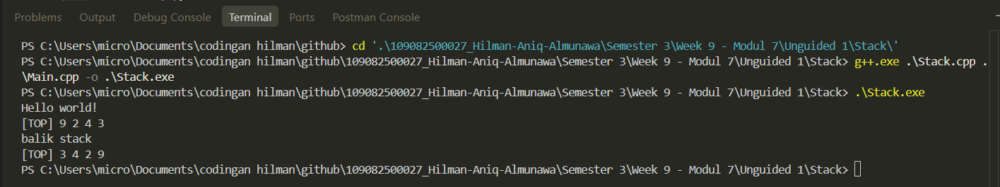
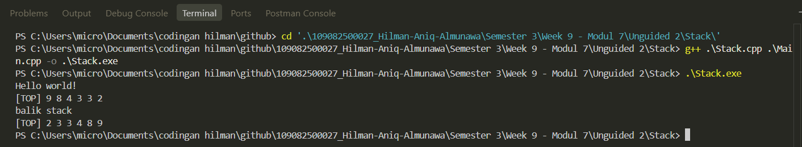
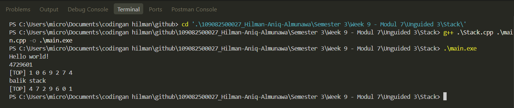

# <h1 align="center">Laporan Praktikum Modul 7 - STACK</h1>
<p align="center">Hilman Aniq Almunawa - 109082500027</p>

## Dasar Teori
Stack merupakan salah satu struktur data linear yang menggunakan prinsip LIFO (Last In First Out), yaitu elemen yang terakhir dimasukkan akan menjadi elemen pertama yang dikeluarkan. Struktur data ini bekerja seperti tumpukan barang, di mana penambahan dan pengambilan elemen hanya dilakukan melalui bagian paling atas yang disebut Top. Menurut Goodrich, Tamassia, dan Mount (2011), stack memungkinkan penyisipan dan penghapusan elemen dengan urutan LIFO. Oleh karena itu, stack memiliki dua operasi utama, yaitu push untuk menambahkan elemen ke dalam tumpukan dan pop untuk mengambil atau menghapus elemen paling atas.

Implementasi stack dapat dilakukan menggunakan dua representasi, yaitu pointer dan tabel (array). Pada representasi pointer, setiap elemen disimpan dalam sebuah node yang memiliki bagian info untuk menyimpan data dan next untuk menunjuk ke elemen berikutnya. Struktur ini menggunakan pointer Top sebagai penunjuk elemen paling atas. Sementara itu, pada representasi tabel, elemen disimpan menggunakan array dengan variabel Top sebagai penanda posisi elemen teratas. Pada stack dengan representasi tabel, kondisi kosong ditandai dengan Top bernilai 0, sedangkan penambahan elemen dilakukan dengan menaikkan nilai Top dan penghapusan elemen dilakukan dengan menurunkan nilai Top (Modul 7, t.t.). Kedua representasi tersebut memiliki prinsip operasi yang sama, tetapi berbeda dalam cara penyimpanan dan pengelolaan memorinya (Morin, 2013).

## Guided 

### 1. Stack.h
```C++
#ifndef STACK_H_INCLUDED
#define STACK_H_INCLUDED

struct infotype {
    char nim[20];
    char nama[20];
};
struct Stack {
    infotype info[10];
    int Top;
};

int isEmpty(Stack S);

void createStack(Stack &S);

void push(Stack &S, infotype X);

void pop(Stack &S, infotype &X);

void viewStack(Stack S);

#endif
```
#### penjelasan guided 1
Pada file `stack.h`, dibuat struktur data Stack menggunakan array untuk menyimpan data mahasiswa berupa NIM dan nama. Di dalamnya terdapat `info[10]` untuk menampung 10 data mahasiswa dan `Top` untuk menunjukkan posisi paling atas pada stack. Selain itu, terdapat deklarasi fungsi yang digunakan untuk membuat stack kosong, mengecek apakah stack kosong, menambahkan data, menghapus data paling atas, dan menampilkan seluruh data yang ada di dalam stack.

### 2. Stack.cpp
```C++
#include "stack.h"

int isEmpty(Stack S) {
    if (S.Top == 0) {
        return 0;
    } else {
        return 1;
    }
}

void createStack(Stack &S) {
    S.Top = 0;
}

void push(Stack &S, infotype X) {
    if (S.Top < 10) { 
        S.Top = S.Top + 1;
        S.info[S.Top - 1] = X;
    } else {
       cout << "Stack penuh, data tidak bisa di tambahkan" << endl;
    }
}

void pop(Stack &S, infotype &X) {
    if (isEmpty(S) == 0) {
        X = S.info[S.Top - 1];
        S.Top = S.Top - 1;
    } else {
        cout << "Stack kosong, tidak ada data yang bisa diambil" << endl;
    }
}

void viewStack(Stack S) {
    if (isEmpty(S) == 0) {
        cout << "Stack kosong" << endl;
    } else {
        cout << "isi stack (dari TOP): " << endl;
        for (int i = S.Top; i >= 1; i--) {
            cout << i << ". " << S.info[i - 1].nim << " - "
                << S.info[i - 1].nama << endl;
        }
    }
}
```
#### penjelasan guided 2
Pada file `stack.cpp`, dibuat implementasi dari fungsi-fungsi yang sudah dideklarasikan di `stack.h`. Fungsi `createStack` digunakan untuk membuat stack kosong, `isEmpty` untuk mengecek kondisi stack, `push` untuk menambahkan data mahasiswa, dan `pop` untuk mengambil data paling atas. Selain itu, terdapat fungsi `viewStack` untuk menampilkan seluruh data mahasiswa yang ada di dalam stack mulai dari posisi TOP sampai data paling bawah.

### 3. main.cpp
```C++
#include <iostream>
#include <cstring>
#include "stack.h"
using namespace std;

int main() {
    Stack S;
    infotype X;
    infotype data, hasil;

    createStack(S);
    cout << "Stack baru dibuat, top = " << S.Top << endl;
    viewStack(S);

    cout << endl << "--- Push 3 data ---" << endl;
    strcpy(data.nim, "103112400001");
    strcpy(data.nama, "Andi");
    push(S, data);

    strcpy(data.nim, "103112400002");
    strcpy(data.nama, "Budi");
    push(S, data);

    strcpy(data.nim, "103112400003");
    strcpy(data.nama, "Citra");
    push(S, data);
    viewStack(S);

    cout << endl << "--- Pop 1 data ---" << endl;
    pop(S, hasil);
    viewStack(S);

    cout << endl << "--- Pop sampai kosong ---" << endl;
    pop(S, hasil);
    pop(S, hasil);
    pop(S, hasil);
    viewStack(S);

    return 0;
}
```
#### penjelasan guided 3
Pada file `main.cpp`, dibuat program utama untuk menjalankan operasi Stack menggunakan data mahasiswa berupa NIM dan nama. Program dimulai dengan membuat stack kosong, lalu memasukkan 3 data mahasiswa menggunakan fungsi `push`. Setelah itu, dilakukan `pop` untuk mengambil data paling atas, kemudian dilanjutkan sampai stack kosong. Setiap proses ditampilkan menggunakan `viewStack` agar perubahan isi stack bisa dilihat.

## Unguided 

### 1. Stack
```C++
#ifndef STACK_H
#define STACK_H

typedef int infotype;

struct Stack {
    infotype info[20];
    int top;
};

void createStack(Stack &S);
void push(Stack &S, infotype x);
infotype pop(Stack &S);
void printInfo(Stack S);
void balikStack(Stack &S);

#endif

------------------------------------------------------------------------------------------------------------------------------------------

Stack.cpp
#include <iostream>
#include "stack.h"
using namespace std;

void createStack(Stack &S) {
    S.top = 0;
}

void push(Stack &S, infotype x) {
    if (S.top == 20) {
        cout << "Stack penuh." << endl;
        return;
    }

    S.info[S.top] = x;
    S.top++;
}

infotype pop(Stack &S) {
    if (S.top == 0) {
        cout << "Stack kosong." << endl;
        return 0;
    }

    S.top--;
    return S.info[S.top];
}

void printInfo(Stack S) {
    cout << "[TOP]";

    for (int i = S.top - 1; i >= 0; i--) {
        cout << " " << S.info[i];
    }

    cout << endl;
}

void balikStack(Stack &S) {
    int kiri = 0;
    int kanan = S.top - 1;

    while (kiri < kanan) {
        infotype temp = S.info[kiri];
        S.info[kiri] = S.info[kanan];
        S.info[kanan] = temp;

        kiri++;
        kanan--;
    }
}

----------------------------------------------------------------------------------------------------------------------------------------

Main.cpp
#include <iostream>
#include "stack.h"
using namespace std;

int main() {
    cout << "Hello world!" << endl;

    Stack S;
    createStack(S);

    push(S, 3);
    push(S, 4);
    push(S, 8);
    pop(S);
    push(S, 2);
    push(S, 3);
    pop(S);
    push(S, 9);

    printInfo(S);

    cout << "balik stack" << endl;
    balikStack(S);
    printInfo(S);

    return 0;
}
```
#### Output Unguided 1 :
##### Output 1


#### penjelasan unguided 1 
Di file stack.h dibuat struktur Stack menggunakan array dengan kapasitas 20 elemen. Di sini juga dideklarasikan fungsi-fungsi yang akan digunakan untuk mengelola Stack.Di file stack.cpp dibuat isi dari fungsi-fungsi tersebut, mulai dari membuat Stack kosong, menambahkan dan mengambil data, menampilkan isi Stack, sampai membalik urutan Stack.Di file main.cpp dibuat program utama untuk mencoba operasi push dan pop sesuai instruksi soal. Setelah itu, isi Stack ditampilkan, kemudian dibalik menggunakan balikStack() dan ditampilkan kembali.

### 2. Stack
```C++
Stack.h
#ifndef STACK_H
#define STACK_H

typedef int infotype;

struct Stack {
    infotype info[20];
    int top;
};

void createStack(Stack &S);
void push(Stack &S, infotype x);
infotype pop(Stack &S);
void printInfo(Stack S);
void balikStack(Stack &S);

//code tambahan yg di pake buat jawab soal no 2
void pushAscending(Stack &S, infotype x);

#endif

---------------------------------------------------------------------------------------------------------------------------------------

Stack.cpp
#include <iostream>
#include "stack.h"
using namespace std;

void createStack(Stack &S) {
    S.top = 0;
}

void push(Stack &S, infotype x) {
    if (S.top == 20) {
        cout << "Stack penuh." << endl;
        return;
    }

    S.info[S.top] = x;
    S.top++;
}

infotype pop(Stack &S) {
    if (S.top == 0) {
        cout << "Stack kosong." << endl;
        return 0;
    }

    S.top--;
    return S.info[S.top];
}

void printInfo(Stack S) {
    cout << "[TOP]";

    for (int i = S.top - 1; i >= 0; i--) {
        cout << " " << S.info[i];
    }

    cout << endl;
}

void balikStack(Stack &S) {
    int kiri = 0;
    int kanan = S.top - 1;

    while (kiri < kanan) {
        infotype temp = S.info[kiri];
        S.info[kiri] = S.info[kanan];
        S.info[kanan] = temp;

        kiri++;
        kanan--;
    }
}

//code tambahan yg di pake buat jawab soal no 2
void pushAscending(Stack &S, infotype x) {
    if (S.top == 20) {
        cout << "Stack penuh." << endl;
        return;
    }

    int i = S.top;

    while (i > 0 && S.info[i - 1] > x) {
        S.info[i] = S.info[i - 1];
        i--;
    }

    S.info[i] = x;
    S.top++;
}

-------------------------------------------------------------------------------------------------------------------------------------

Main.cpp
#include <iostream>
#include "stack.h"
using namespace std;

int main() {
    cout << "Hello world!" << endl;

    Stack S;
    createStack(S);

    //code tambahan yg di pake buat jawab soal no 2
    pushAscending(S, 3);
    pushAscending(S, 4);
    pushAscending(S, 8);
    pushAscending(S, 2);
    pushAscending(S, 3);
    pushAscending(S, 9);

    printInfo(S);

    cout << "balik stack" << endl;
    balikStack(S);
    printInfo(S);

    return 0;
}
```
### Output Unguided 2 :

##### Output 1


#### penjelasan unguided 2

Di file stack.h ditambahkan deklarasi fungsi pushAscending yang digunakan untuk memasukkan data ke dalam Stack secara berurutan.Di file stack.cpp dibuat fungsi pushAscending untuk mengatur posisi data agar tersusun dari nilai terkecil hingga terbesar di dalam array.Di file main.cpp dilakukan pengujian dengan memasukkan enam angka menggunakan pushAscending. Setelah itu, isi Stack ditampilkan, kemudian dibalik menggunakan balikStack() dan ditampilkan kembali.

### 3. Stack
```C++
Stack.h
#ifndef STACK_H
#define STACK_H

typedef int infotype;

struct Stack {
    infotype info[20];
    int top;
};

void createStack(Stack &S);
void push(Stack &S, infotype x);
infotype pop(Stack &S);
void printInfo(Stack S);
void balikStack(Stack &S);

//code tambahan yg di pake buat jawab soal no 2
void pushAscending(Stack &S, infotype x);

//code tambahan yg di pake buat jawab soal no 3
void getInputStream(Stack &S);

#endif

-------------------------------------------------------------------------------------------------------------------------------------

Stack.cpp
#include <iostream>
#include "stack.h"
using namespace std;

void createStack(Stack &S) {
    S.top = 0;
}

void push(Stack &S, infotype x) {
    if (S.top == 20) {
        cout << "Stack penuh." << endl;
        return;
    }

    S.info[S.top] = x;
    S.top++;
}

infotype pop(Stack &S) {
    if (S.top == 0) {
        cout << "Stack kosong." << endl;
        return 0;
    }

    S.top--;
    return S.info[S.top];
}

void printInfo(Stack S) {
    cout << "[TOP]";

    for (int i = S.top - 1; i >= 0; i--) {
        cout << " " << S.info[i];
    }

    cout << endl;
}

void balikStack(Stack &S) {
    int kiri = 0;
    int kanan = S.top - 1;

    while (kiri < kanan) {
        infotype temp = S.info[kiri];
        S.info[kiri] = S.info[kanan];
        S.info[kanan] = temp;

        kiri++;
        kanan--;
    }
}

//code tambahan yg di pake buat jawab soal no 2
void pushAscending(Stack &S, infotype x) {
    if (S.top == 20) {
        cout << "Stack penuh." << endl;
        return;
    }

    int i = S.top;

    while (i > 0 && S.info[i - 1] > x) {
        S.info[i] = S.info[i - 1];
        i--;
    }

    S.info[i] = x;
    S.top++;
}

//code tambahan yg di pake buat jawab soal no 3
void getInputStream(Stack &S) {
    char input;

    while (cin.get(input) && input != '\n') {
        if (input >= '0' && input <= '9') {
            push(S, input - '0');
        }
    }
}

-----------------------------------------------------------------------------------------------------------------------------------------

Main.cpp
#include <iostream>
#include "stack.h"
using namespace std;

int main() {
    cout << "Hello world!" << endl;

    Stack S;
    createStack(S);

    //code tambahan yg di pake buat jawab soal no 3
    getInputStream(S);

    printInfo(S);

    cout << "balik stack" << endl;
    balikStack(S);
    printInfo(S);

    return 0;
}
```
### Output Unguided 3 :

##### Output 1


#### penjelasan unguided 3
Di file stack.h ditambahkan deklarasi fungsi getInputStream yang digunakan untuk membaca input dari user.Di file stack.cpp dibuat fungsi getInputStream yang membaca setiap karakter menggunakan cin.get(). Setiap angka yang dimasukkan akan disimpan ke dalam Stack sampai user menekan Enter.Di file main.cpp ditambahkan pemanggilan getInputStream() untuk menerima input dari user. Setelah itu, isi Stack ditampilkan dan dibalik menggunakan balikStack().

## Kesimpulan
Berdasarkan praktikum Modul 7, dapat disimpulkan bahwa Stack merupakan struktur data yang menggunakan prinsip LIFO (Last In First Out), yaitu data yang terakhir dimasukkan akan menjadi data pertama yang dikeluarkan. Pada praktikum ini dipelajari cara membuat dan mengelola Stack menggunakan array dengan bantuan beberapa fungsi, seperti createStack(), push(), pop(), printInfo(), dan balikStack().

Selain itu, dilakukan juga pengembangan fungsi pushAscending() untuk memasukkan data secara berurutan dan getInputStream() untuk menerima input dari user hingga menekan Enter. Melalui praktikum ini, saya menjadi lebih memahami cara kerja Stack, penggunaan array, serta penerapan operasi-operasi Stack dalam program C++.

## Referensi
[1] Modul 7. (t.t.). Stack (hlm. 59–65). Modul Praktikum Struktur Data.

[2] Goodrich, M. T., Tamassia, R., & Mount, D. M. (2011). Data Structures and Algorithms in C++ (2nd ed.). John Wiley & Sons.

[3] Morin, P. (2013). Open Data Structures: An Introduction. Athabasca University Press. https://doi.org/10.15215/aupress/9781927356388.01
